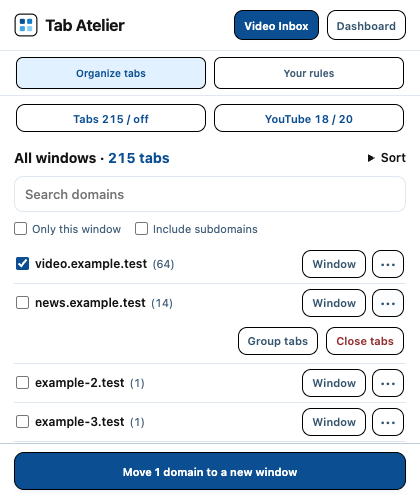
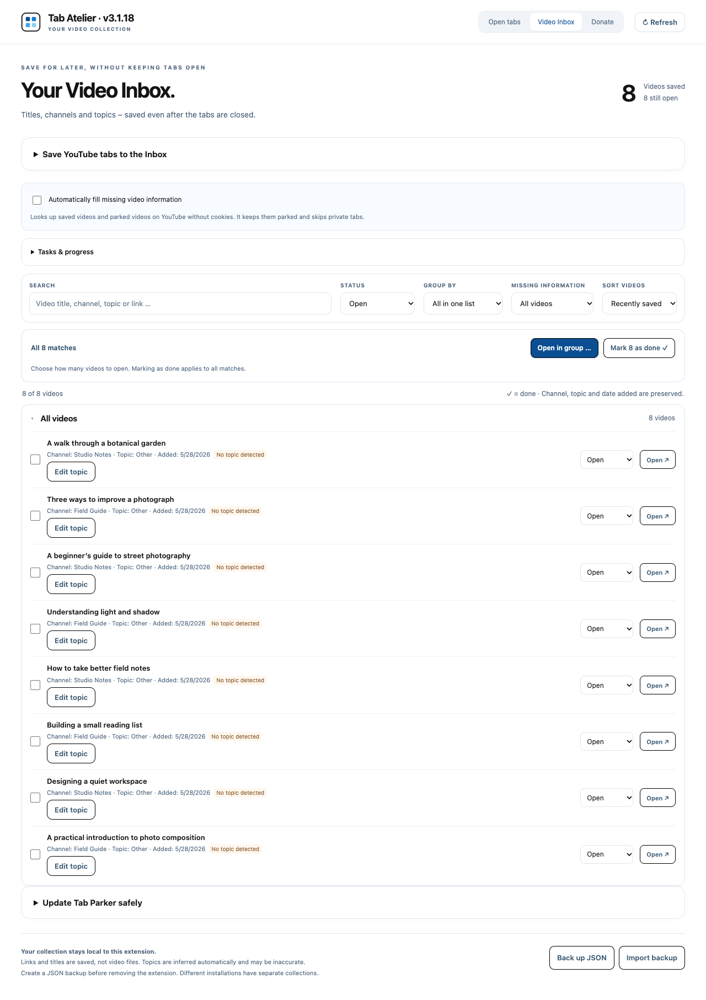

# Tab Atelier for Chrome

Organize open tabs by domain, save YouTube videos to a local Inbox, and reopen videos in groups when you are ready to watch.

[Download the latest release](https://github.com/fbn90/tab-atelier-chrome/releases/latest)

## Features

### Organize tabs and windows

- **See what is open.** The toolbar badge shows the total tab count. The popup and dashboard list tabs by domain across windows, with a filter for the current window.
- **Move a website into its own window.** Use **Window** beside a domain to gather its tabs into one new window. Select one or more domains to show the button that moves the selection into a single new window. Regular and private windows stay separate. Choose **•••** to show **Group tabs** and **Close tabs** underneath that domain. Press Escape to collapse the row.
- **Sort tabs by domain.** Under **Sort**, choose **Sort this window A–Z** to keep groups together, or **One window per domain** to distribute ungrouped, unpinned web tabs, even with automatic routing off. Enable automatic domain routing to send new tabs to their matching windows.
- **Sort by opening order.** Sort the current window from oldest to newest. Clean up duplicate tabs manually or enable automatic duplicate cleanup.

### Protect your tab limits

- **Set two independent limits.** Choose a maximum for all open tabs and a separate maximum for open YouTube videos, including parked Tab Parker videos.
- **Save older videos automatically.** When the YouTube limit is exceeded, Tab Atelier saves the oldest eligible videos to the Video Inbox and verifies the saved link before closing the tab.
- **Make an exception for a group.** Approve a larger Inbox group explicitly. The group's videos are protected from automatic archiving and still count toward the total limit.

### Manage YouTube videos

- Group open videos by channel or topic, automatically or from the dashboard.
- Save and search videos in the local Video Inbox. Open individual videos or 10, 20 or all matches as a group. Each confirmed opening removes that video from the Inbox, including when an existing tab is reused. Failed and skipped videos stay saved. Saving or importing multiple links with the same YouTube video ID creates a single entry, regardless of timestamp or URL format.
- Export open YouTube videos as JSON, or export and import a separate Video Inbox backup.

## Install

1. Download the extension ZIP from Releases and extract it to a permanent folder.
2. Open `chrome://extensions` and enable **Developer mode**.
3. Choose **Load unpacked** and select the extracted folder containing `manifest.json`. Pin the extension if you want its popup in the toolbar.

For an update, keep the same local extension directory so Chrome retains the extension ID and its local settings. Back up your Inbox before changing installations.

If Tab Parker is installed with a different extension ID than the Chrome Web Store version, confirm it once in the Video Inbox under **Connect Tab Parker**. Until then, Inbox videos open directly on YouTube.

## Screenshots

## Privacy

Browser tab details and Inbox backups stay on your device. Optional metadata lookup contacts YouTube without cookies.

## Development

Run the JavaScript checks with `npm test`.

With Playwright and a recent Chromium installed, run `node tests/popup-domains-browser.mjs` to check domain actions and keyboard focus in the toolbar popup. Set `CHROME_PATH` to use a different Chromium executable. The test creates its own temporary profile.

## License

[MIT](LICENSE).
